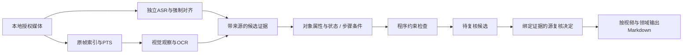

# 架构与数据流

## 数据边界

- 来源身份：视频身份、源文件校验、帧/PTS、裁切与输入参数。
- 模型回执：实际输入与提示身份、原文输出、格式状态、时间成本。
- 程序记录：精确引用、字段合法性、来源绑定、矛盾和未覆盖区间。
- 参考标注：推理前冻结，仅离线评分读取；不得反馈给模型选择答案。
- 源复核：与事实校验值绑定，单独保存；当前参考常由Codex完成，不是独立人工金标准。
- 知识输出：已认可内容与待复核候选明确区分。

## v6追加机制

`initial` 是不可覆盖的初始观察。`additional` 保存编码对照或定向补读，带独立来源和用途。`summarize_record` 列出候选值、冲突及支持记录，`automatic_value` 保持为空。

同模型多次输出不是独立核验。格式化、哈希和坐标存在性只能验证记录关系，不能证明画面识别正确。

## 当前结构的实际限制

项目是一组版本化实验入口，尚未合并成稳定产品CLI。部分历史准备入口依赖特定本地目录和材料格式；基础测试可独立运行，完整语义实验需要素材。没有自动对象发现、可靠跨帧追踪或完整收藏夹调度。
